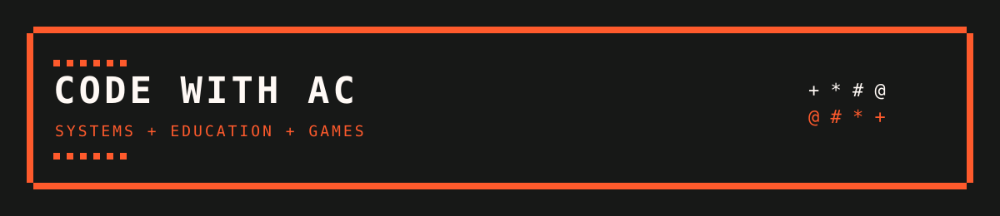

<!-- Profile README for AlexCrean -->

  

~~~text
+------------------------------------------------------------+
|  ALEX CREAN                                                |
|  SYSTEMS + EDUCATION + GAMES                               |
|  + * # @                                                    |
+------------------------------------------------------------+
~~~

# Alex Crean

### FE & HE Lecturer in Games and Computing · CTO @ Serious Point Games

> Solution-oriented architecture engineer and creative technologist working across education, games technology and production systems.

## About

With a passion for creating and a love for the process, I focus on systems architecture and technical development, predominantly in C#, while also working across production management and development operations.

My long-term focus is strengthening the relationship between education, academia and the games industry, helping learners build the technical judgement, accountability and practical confidence expected in production environments.

## Current work

- **Farnborough College of Technology**  
  FE/HE Lecturer in Games and Computing and Course Leader for BA (Hons) Games Design and Development. I teach across Unity, system architecture, project management, UX, testing, change management and DevOps.

- **Serious Point Games**  
  Co-Founder, Chief Technical Officer and Productions Manager. I lead technical business needs, automation, single sources of truth, change management and distributed development pipelines.

## Selected work

###  Code With AC

A live, teacher-led classroom platform for programming, computing and game-development education. It combines interactive activities, learner support, formative signals and progression.

Built with TypeScript, Vite, PostgreSQL, Deno and Cloudflare.

###  Systems and data

A privacy-conscious retrieval-augmented knowledge pipeline backed by SQLite, scheduled CI/CD, deterministic validation and Obsidian visualisation.

### Games technology

Unity systems and production tooling spanning narrative branching, story variables, linting, save systems, data formatting, automation and player-centred game development.

## Technical focus

- C#, Unity and game systems
- Solution architecture and systems design
- TypeScript, Vite and web platforms
- PostgreSQL, Deno and Cloudflare
- DevOps, automation and single sources of truth
- Production management, change management and curriculum development

## Links

- [Code With AC](https://codewithac.com/)
- [Alex Crean](https://alexcrean.com/)
- [LinkedIn](https://www.linkedin.com/in/alex-crean/)
- [Code With AC on GitHub](https://github.com/code-with-ac)
- [Serious Point Games on GitHub](https://github.com/Serious-Point-Games)
- [FCOT Digital on GitHub](https://github.com/FCOT-Digital)

  Built around clear systems, useful tools and better learning.

